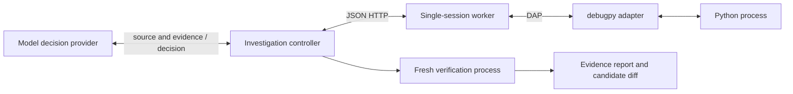
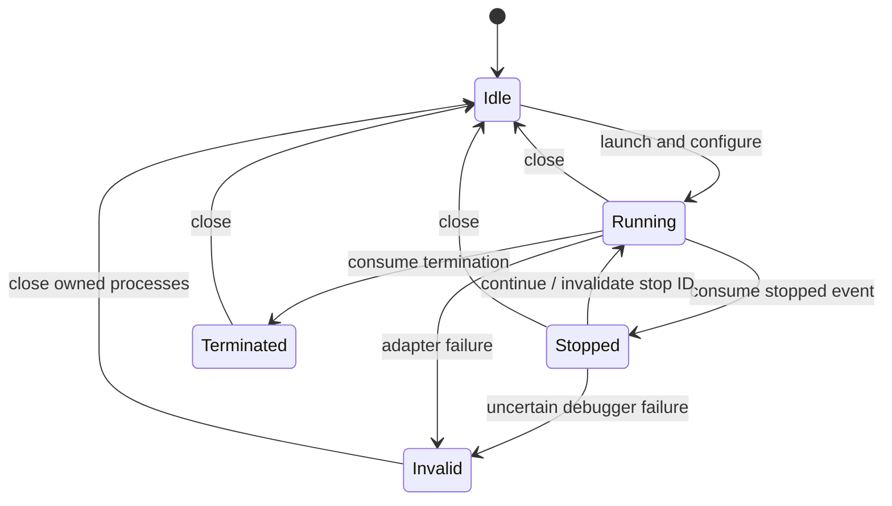

# Peeky design — Python alpha and five-language direction

Status: implemented Python agent foundation and Java worker with explicit limitations. Product MVP requires Python, Java, C, C++, and Rust; see LANGUAGES.md for the implementation order and remaining compiled candidate-verification work. This document specifies the intended MVP contract; the roadmap distinguishes delivered foundations from remaining acceptance work.

## Problem and outcome

Agents often edit source solely to add print statements, rebuild, restart, and infer runtime behavior from logs. Peeky lets an agent inspect execution and conduct a small causal experiment through a debugger. The desired output is a reproducible diagnosis plus a candidate patch and the results of an independent check.

An intervention that improves behavior is evidence, not a permanent repair. A patch is accepted only after a fresh execution of the configured verifier completes successfully and the original source/verifier hashes are unchanged.

## Boundaries

Current alpha: trusted, standalone Python scripts; one worker session; one controller; local launch; loopback HTTP or SSH forwarding. Debugpy handles Python runtime semantics. DAP is the adapter boundary. The model selects experiments; ordinary code enforces IDs, time limits, operation ordering, and verification requirements.

Out of scope: hostile-code isolation, arbitrary production mutation, multi-user tenancy, general multi-file automatic edits, Kubernetes installation, outbound gateway, reverse debugging, replay, and attaching to unprepared processes.

## Current Python alpha components

| Module | Responsibility | Must not own |
| --- | --- | --- |
| `agent` | Model decisions, investigation budget, experiment sequencing, candidate proposal | Debugger protocol parsing |
| `client` | HTTP request/response transport | Automatic mutation retries |
| `worker` | Session identity, state transitions, input validation, target access, operations | Model reasoning |
| `dap` | Framing, response matching, asynchronous events, child lifecycle | Hypothesis selection |
| `adapters` | Trusted debugger command, initialize/launch configuration, scope and capability normalization | Session identity or model decisions |
| `build` | Fresh copied workspaces, explicit trusted build recipes, source/artifact integrity manifests | Automatic language selection or proof of loaded-image identity |
| verification support | Trusted verifier completion and isolated fresh execution | Editing the verifier |

The current model provider is Codex CLI. The controller takes an injected decision callable, which deterministic tests replace. Extract a provider protocol when a second provider is added; do not build a registry before it has users.

## Session model

- A new launch creates a random session ID and a source fingerprint.
- Each consumed stop creates a new stop ID. Frame and scope references are valid only at that stop.
- Inspection and mutation require the current session and stop. Reports require session identity.
- Continue invalidates all frame/scope references.
- A request timeout can mean an operation already executed. Close/invalidate the session; never transparently retry a mutation.
- A worker serializes operations. `wait` uses short bounded polling to limit how long polling delays another request; other adapter operations still have their own request deadlines.
- The CLI worker expires inactive sessions. Graceful disconnect is followed by owned process-group cleanup on supported POSIX hosts.
- Lifecycle events are separate from output buffers, so noisy stdout cannot evict stop/termination events.

Current state is event-consumption based: the controller calls wait to observe asynchronous transitions. A future event stream may replace polling without changing identity semantics.

## HTTP contract

Requests are JSON objects with `Authorization: Bearer <token>`. The worker binds only to 127.0.0.1. The token authorizes control of that worker; it is not a per-target policy. Request sizes are bounded. Errors distinguish invalid requests from uncertain adapter failures through HTTP status and error text. A stable machine-readable error code/version field is a subsequent protocol slice before third-party integrations.

| Operation | Required input | Result |
| --- | --- | --- |
| launch | worker-relative program, breakpoint list | session ID, source hash, capabilities, verified locations |
| wait | session ID, bounded timeout | stopped, terminated, or still running |
| inspect | session ID, stop ID, optional frame ID | stack and bounded locals |
| set_variable | session ID, stop ID, scope reference, name, expression value | before/after |
| breakpoints | session ID, program, complete replacement breakpoint list | verified locations |
| continue | session ID, stop ID | running |
| report | session ID | bounded output and operation history |
| close | session ID | idle; owned process teardown |

Client-visible IDs have no meaning across sessions/stops. DAP capabilities must be checked before adding optional operations. Breakpoint line relocation must be returned to the agent, not silently treated as the requested line.

## Current Python alpha agent loop

The model receives numbered source, a plain-language issue, baseline execution/check failures, and prior observations. It returns a structured action:

1. `observe(line)` launches a fresh process and inspects a chosen stop.
2. `intervene(variable, value)` changes an observed local, removes breakpoints, resumes, and returns the runtime outcome.
3. `finish(old, new, reason)` proposes one exact replacement in the source.

The controller rejects a finish before runtime intervention. It writes a separate candidate, never silently overwrites the original, and verifies in a fresh process. A failed check returns to the model for another decision. The total number of decisions and per-call/runtime deadlines are bounded. Transport failures are fatal to the active session. Model failures produce a failed report, not a fabricated diagnosis.

This vocabulary is intentionally small. Repeated observation, stepping, selected object expansion, condition/logpoint UI, attach, and multiple hypotheses are later additions with their own contract tests.

## Verification and evidence

The configured verifier accepts the candidate path in argv[1], must fail on the original, and must return normally after checking the candidate. An explicit sys.exit(0) is intentionally rejected. A trusted wrapper requires explicit completion rather than interpreting every zero process exit as success. Catching premature `SystemExit` prevents the demonstrated exit-zero bypass. Hash checks gate acceptance, not just report annotations.

This is not adversarially secure verification: target and verifier execute with local OS permissions; malicious native code or deliberate process tampering is outside the trusted-code contract. Strong isolation needs a separate environment and verifier service later.

Evidence includes source/check hashes, actual breakpoint, observed local state, requested intervention, returned value, runtime output, decision reason, proposed edit, and checker completion. A statement that a bug is generally fixed is only as broad as the supplied verifier; test output must not be replaced with model claims.

Reports may include application data. They stay local unless the user explicitly sends them or uses the model runner, which sends selected evidence to the configured model. CI uses synthetic fixtures only and retains test diagnostics in job logs.

## Remote development

The same worker runs on the target host and the reasoning client stays outside. SSH forwards loopback traffic and supplies transport confidentiality/authentication. The bearer token remains an additional worker credential. Source identity must match before line-based debugging.

The root directory constrains entrypoint selection, not filesystem access by the program. Evaluating variable assignments and even rendering objects can invoke user code. Strip the worker control credential from debugger and verification child environments, while retaining normal runtime dependencies needed by trusted programs.

For Kubernetes later: add a per-workload worker with explicit deployment permissions, then an authenticated outbound relay. Define reconnect semantics and allowed data egress before claiming secure production support. Native debugger access may require capabilities or process namespace sharing; a sidecar alone does not establish attachability.

## Delivery strategy

Each roadmap slice includes a runnable example and tests. Required CI is deterministic and parallel: style, unit, real-debugpy integration across two Python versions, and installed-wheel smoke. Real-model evaluations are manual and report separate cost/latency; they never block every PR. Build private artifacts on manual delivery. Public distribution and cluster deployment require separate product decisions.

## Language expansion

Java runtime debugging is now connected to the worker, with candidate source-fix verification still next. A shared native adapter will then be qualified separately for C, C++, and Rust. See LANGUAGES.md for full per-language acceptance criteria.

Launch/scope configuration lives behind trusted startup adapter objects. HTTP clients cannot provide adapter commands. JavaTarget prepares fresh copied inputs, compiles debug classes and generates source mappings directly from class metadata. JavaSession checks build, bundle and mapping identities before guarded operations, validates selected stopped frames and cleans its workspace after debugger teardown. The worker retains session/stop ownership and exposes eventual breakpoint verification events. The build boundary is not yet connected to controller candidate acceptance. See JAVA_WORKER.md for restrictions and trusted-development provenance limits.

## Open questions

- How should compiled candidate verification extend the current source-patch controller?
- Should a future agent receive stable evidence IDs instead of raw DAP scopes?
- What needs to remain inside customer infrastructure before remote production use?
- Which regression corpus provides evidence beyond synthetic examples?
- Is latency improved more by batching observations or by keeping one model session?
