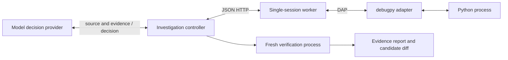
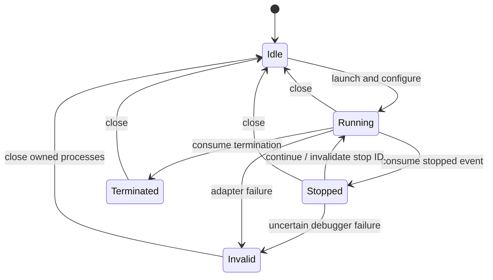

# Peeky design

Status: Python, Java, C, C++ and Rust each have an experimental investigation loop, with explicit
limits. The product MVP needs all five. [LANGUAGES.md](LANGUAGES.md) has the implementation order,
and the language and remote acceptance work that remains. This document specifies the intended MVP
contract. The [roadmap](ROADMAP.md) tells delivered foundations from remaining acceptance work.

## Problem and outcome

Agents often edit source only to add print statements. They rebuild, restart, and infer runtime
behavior from logs. Peeky lets an agent inspect execution through a debugger, and run a small
causal experiment. The output is a reproducible diagnosis, a candidate patch, and the results of
an independent check.

- An intervention that improves behavior is evidence, not a permanent repair.
- A patch is accepted only after a fresh run of the configured verifier completes successfully.
  The original source's and verifier's hashes must also be unchanged.

## Boundaries

In scope:

- trusted programs, not hostile ones;
- one session per worker, and one controller;
- local launch, or attaching to a Java VM that waits for a debugger
  ([JAVA_ATTACH.md](JAVA_ATTACH.md));
- loopback HTTP, or SSH forwarding.

Who does what:

- The debugger handles each language's runtime semantics: debugpy for Python. DAP is the adapter
  boundary.
- The model selects experiments.
- Ordinary code enforces IDs, time limits, the order of operations, and verification
  requirements.

Out of scope:

- isolating hostile code;
- arbitrary production mutation;
- multi-user tenancy;
- general automatic edits across files;
- Kubernetes installation, and an outbound gateway;
- reverse debugging and replay;
- attaching to processes that weren't prepared for a debugger.

## Components



The diagram shows Python. Java, C, C++ and Rust use their own adapters behind the same worker.

| Module | Responsibility | Must not own |
| --- | --- | --- |
| `agent` | Model decisions, investigation budget, experiment sequencing, candidate proposal | Debugger protocol parsing |
| `client` | HTTP request/response transport | Automatic mutation retries |
| `worker` | Session identity, state transitions, input validation, target access, operations | Model reasoning |
| `dap` | Framing, response matching, asynchronous events, child lifecycle | Hypothesis selection |
| `adapters` | Trusted debugger command, initialize/launch configuration, scope and capability normalization | Session identity or model decisions |
| `build` | Fresh copied workspaces, explicit trusted build recipes, source/artifact integrity manifests | Automatic language selection or proof of loaded-image identity |
| verification support | Trusted verifier completion and isolated fresh execution | Editing the verifier |

The table lists the core modules. Others add the command line (`cli`), stateless probes (`probe`),
the evidence store (`evidence`), error codes (`errors`), and each language's support (`java*`,
`native*`, `rust*`, `python_*`).

The model provider is Codex CLI. The controller takes an injected decision callable, which
deterministic tests replace. Extract a provider protocol when a second provider is added. Don't
build a registry before it has users.

## Session model



**Identities:**

- A new launch creates a random session ID, and a source fingerprint.
- Each consumed stop creates a new stop ID. Frame IDs are valid only at that stop.
- The worker issues opaque scope handles, and translates them to adapter references.
- Every new inspection revokes all earlier scope handles, even within the same stop. This stops a
  reused raw adapter scope ID from selecting the wrong frame.
- Inspection and mutation need the current session and stop. Reports need the session's identity.
- Continue invalidates all frame and scope references.

**Failures and timing:**

- A request timeout can mean that the operation already ran. Close or invalidate the session.
  Never retry a mutation transparently.
- A worker serializes operations. `wait` polls in short, bounded steps, which limits how long
  polling delays another request. Other adapter operations keep their own request deadlines.
- The CLI worker expires inactive sessions. A graceful disconnect is followed by cleanup of the
  owned process group, on supported POSIX hosts.
- Lifecycle events are kept apart from output buffers, so noisy stdout can't push out a stop or
  termination event.

State changes are consumed as events: the controller calls `wait` to observe asynchronous
transitions. A future event stream may replace polling, without changing what the identities mean.

## HTTP contract

Requests are JSON objects with `Authorization: Bearer <token>`.

- The worker binds only to `127.0.0.1`.
- The token authorizes control of that worker. It is not a per-target policy.
- Request sizes are bounded: at most 4 MiB, enough for a remote client's source hashes.
- Errors are JSON with a stable `code`, a `hint`, `retryable` and `session_closed`. Every response
  carries the protocol version. [ERRORS.md](ERRORS.md) lists the codes.
- The HTTP status and the code tell invalid requests apart from uncertain adapter failures.

`POST /version` returns the protocol version, the sources a remote client hashes, the operations
and the error codes:

```
$ curl -s -i -X POST -H 'Authorization: Bearer …' -d '{}' http://127.0.0.1:18766/version
HTTP/1.0 200 OK
...
X-Peeky-Protocol: 2
...
{"protocol": 2, "sources": {"kind": "python"}, "operations": ["breakpoints", "close", "continue", "expand", "inspect", "launch", "preview", "probe", "report", "set_variable", "shutdown", "step", "version", "wait"], "error_codes": ["BUDGET_EXHAUSTED", "BUSY", "DEBUGGER_ERROR", "INSPECT_REQUIRED", "INTERNAL_ERROR", "INVALID_BREAKPOINT", "INVALID_QUERY", "INVALID_REQUEST", "JOB_LOST", "MUTATION_REJECTED", "NOT_FOUND", "NO_SESSION", "PROVENANCE_CHANGED", "SESSION_ACTIVE", "STALE_HANDLE", "STALE_STOP", "TIMEOUT", "TRANSPORT_LOST", "UNAUTHORIZED", "UNREACHABLE", "UNSUPPORTED"]}
```

Without the token, the reply is `401`:

```
{"error": {"code": "UNAUTHORIZED", "message": "Missing or wrong bearer token", "hint": "Use the DEBUG_TOKEN the worker was started with.", "retryable": false, "session_closed": false}, "protocol": 2}
```

| Operation | Required input | Result |
| --- | --- | --- |
| launch | worker-relative program, breakpoint list; remote clients: `expect_sha256` and `expect_inputs` | session ID, source hash, capabilities, verified locations; `inputs_checked` and `inputs_sha256` |
| wait | session ID, bounded timeout | stopped, terminated, or still running; at a `calls` step's own end, `call_change` (`left`, `deeper` or `other`) where its stack, read whole up to 256 frames, differs in function or depth; `macro_stop` (Rust) where the debugger shows the stop on a line with no code of its own in its function that is in a macro's definition, or may be one (Peeky can't read the source as rustc does; the text says which), why `inspect` reads none of that frame; where the function's DWARF blocks are known, only once the stop's address proves it |
| inspect | session ID, stop ID; optional `frame` (index into `frames`, 0 the innermost) or `frame_id`; optional `names` (up to 32 names also listed past the 50-entry bound; a shadowed local's as LLDB names it, `s @ main.rs:81`); optional `globals` (Python: `true` lists the module's globals; a list of names lists them only if the function provably reads one of those names from them, with `globals_proof`) | stack and bounded locals (`frame`, `innermost` for a caller, `globals_available`); Python values carry `identity`; `no_longer_visible`: after a `calls` step that stayed in the function at its depth, names listed at an earlier stop and not here, with `same_call` where the debugger's steps prove it (Java); not Python |
| expand | session ID, stop ID, opaque child handle, start/count | bounded read-only children |
| preview | session ID, stop ID, child handle; optional `pointee` | the value's preview, as `inspect` shows it, or none |
| set_variable | session ID, stop ID, scope reference, name, expression value (the innermost frame's only) | before/after |
| breakpoints | session ID, program, complete replacement breakpoint list | verified locations |
| continue | session ID, stop ID; optional `to_line` or `to_exit` | running |
| step | session ID, stop ID; `kind`: `over`, `in` or `out`; optional `calls` (the step's own end is compared with this stop) | running |
| report | session ID | bounded output and operation history |
| close | session ID | idle; owned process teardown |
| probe | one stateless request: `at`, `capture`, optional `set` and the probe's other options ([ADR 0004](adr/0004-stateless-probes.md)) | the probe's result |
| version | none | protocol version, the sources a client hashes, the worker's root, operations, error codes |
| shutdown | none | the worker closes its session and stops |

- Client-visible IDs mean nothing across sessions or stops.
- Check DAP capabilities before adding an optional operation.
- When a breakpoint's line is relocated, return the actual line to the agent. Never treat it
  silently as the requested line.

## The agent loop (`peeky-agent`)

The model receives the numbered source, a plain-language issue, the baseline run's and checks'
failures, and earlier observations. It returns one structured action:

1. `observe(line)` launches a fresh process, and inspects a chosen stop.
2. `intervene(variable, value)` changes an observed local, removes breakpoints, resumes, and returns
   the runtime outcome.
3. `finish(old, new, reason)` proposes one exact replacement in the source.

The controller:

- rejects a `finish` before a runtime intervention;
- writes a separate candidate, and never overwrites the original silently;
- verifies the candidate in a fresh process. A failed check goes back to the model for another
  decision;
- bounds the total number of decisions, and each call's and run's deadlines;
- treats a transport failure as fatal to the active session;
- turns a model failure into a failed report, never a made-up diagnosis.

This vocabulary is small on purpose:

- The worker also supports bounded read-only expansion, and stepping. The agent's vocabulary
  selects neither yet.
- Multiple hypotheses remain a later addition, with their own contract tests.
- Conditional breakpoints, hit conditions and logpoints are refused for every language. They are
  expressions the debuggee would evaluate, and Peeky never runs agent-supplied code in the program.

## Verification and evidence

The configured verifier gets the candidate's path in `argv[1]`.

- It must fail on the original.
- It must return normally after checking the candidate. An explicit `sys.exit(0)` is rejected on
  purpose.
- A trusted wrapper requires explicit completion, instead of taking every zero exit as success.
  Catching a premature `SystemExit` prevents the exit-zero bypass that was demonstrated.
- Hash checks gate acceptance. They are not only notes in the report.

This is not adversarially secure verification. The target and the verifier run with local OS
permissions. Malicious native code, or deliberate process tampering, is outside the trusted-code
contract. Strong isolation needs a separate environment and verifier service, later.

Evidence includes:

- source and check hashes;
- the actual breakpoint, and the observed local state;
- the requested intervention, and the returned value;
- the runtime output;
- the decision's reason, the proposed edit, and the checker's completion.

A claim that a bug is fixed in general is only as broad as the supplied verifier. Model claims must
never replace test output.

Reports may include application data. They stay local, unless the user sends them, or uses the
model runner, which sends selected evidence to the configured model. CI uses synthetic fixtures
only, and keeps test diagnostics in job logs.

## Remote development

The same worker runs on the target host, and the reasoning client stays outside
([REMOTE.md](REMOTE.md)).

- SSH forwards loopback traffic, and supplies transport confidentiality and authentication.
- The bearer token remains an additional worker credential.
- Source identity must match before line-based debugging.
- The root directory constrains which entry point is chosen, not what files the program can reach.
- Evaluating variable assignments, and even rendering objects, can run user code.
- Strip the worker's control credential from the environments of debugger and verification
  children. Keep the normal runtime dependencies that trusted programs need.

For Kubernetes, later:

- Add a per-workload worker with explicit deployment permissions, then an authenticated outbound
  relay.
- Define reconnect semantics, and what data may leave, before claiming secure production support.
- Native debugger access may need capabilities, or a shared process namespace. A sidecar alone
  doesn't make a process attachable.

## Delivery strategy

- Each roadmap slice includes a runnable example and tests.
- Required CI is deterministic and parallel: style, unit, real-debugpy integration on two Python
  versions, and an installed-wheel smoke test. Each language adds its own lane
  ([TESTING.md](TESTING.md)).
- Real-model evaluations are manual, and report cost and latency separately. They never block a
  PR.
- Private artifacts are built on manual delivery.
- Public distribution and cluster deployment need separate product decisions.

## Language expansion

Java, C, C++ and Rust runtime debugging, and fresh candidate verification, are connected to the
worker and controller. C++ adds qualified class, reference and array inspection, and candidate
verification. Rust has a worker for one dependency-free Cargo binary
([RUST_AGENT.md](RUST_AGENT.md#the-cargo-build)), and an investigation loop
([AGENT_LOOP.md](AGENT_LOOP.md#rusts-two-gates)).
[LANGUAGES.md](LANGUAGES.md) has the full acceptance criteria per language.

How the languages plug in:

- Launch and scope configuration live behind trusted startup adapter objects. HTTP clients can't
  supply adapter commands.
- `JavaTarget` prepares fresh copies of the inputs, compiles debug classes, and generates source
  mappings straight from class metadata.
- `JavaSession` checks the build, bundle and mapping identities before guarded operations. It
  validates selected stopped frames, and cleans its workspace after the debugger's teardown.
- The worker keeps ownership of sessions and stops, and exposes the debugger's later
  breakpoint-verification events.
- Java and C candidate acceptance use the shared `CompiledVerification` lifecycle, with thin
  language wrappers, fresh prepared builds and the unchanged trusted checker.

[Java 7.3](lang/java-cookbook.md#what-peeky-checks-about-a-java-build) has the restrictions, and the
limits of provenance for trusted development.

## Open questions

- How should compiled candidate verification extend the source-patch controller? (Answered for
  Java and C by `CompiledVerification`, above.)
- Should a future agent receive stable evidence IDs, beside opaque worker scope handles?
- What needs to stay inside customer infrastructure before remote production use?
- Which regression corpus gives evidence beyond synthetic examples?
- Is latency improved more by batching observations, or by keeping one model session?

## Bounded child inspection

Inspection returns opaque child handles in `variablesReference`, distinct from writable scope
references.

- Expansion revalidates the stopped frame, source and module. It resolves a unique scope, and the
  exact ancestry of names and types, afresh.
- Reinspection, mutation attempts, stop transitions, continuation and close revoke child handles.
- Expansion revokes earlier writable scope handles, because resolving children can change the
  backend's scope context. Inspect again before a mutation.

Limits:

- A page holds at most 64 values. Depth is at most four.
- An inspection has a 512-node budget, which includes the initial locals.
- A collection beyond 512 entries is rejected. Backend paging can't silently get around these
  limits.
- Values and identity strings are bounded.
- Child handles never authorize mutation.

These reads don't call arbitrary evaluate commands. But a trusted debugger's formatting may have
runtime side effects. The qualified fixture doesn't imply general support for C++ projects or
formatters.
